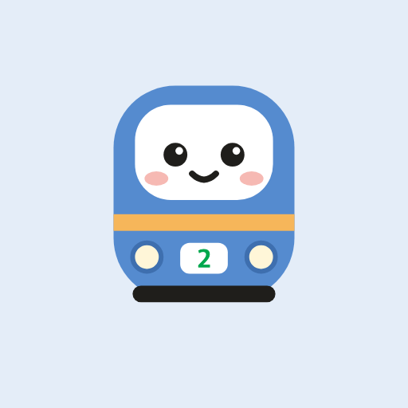
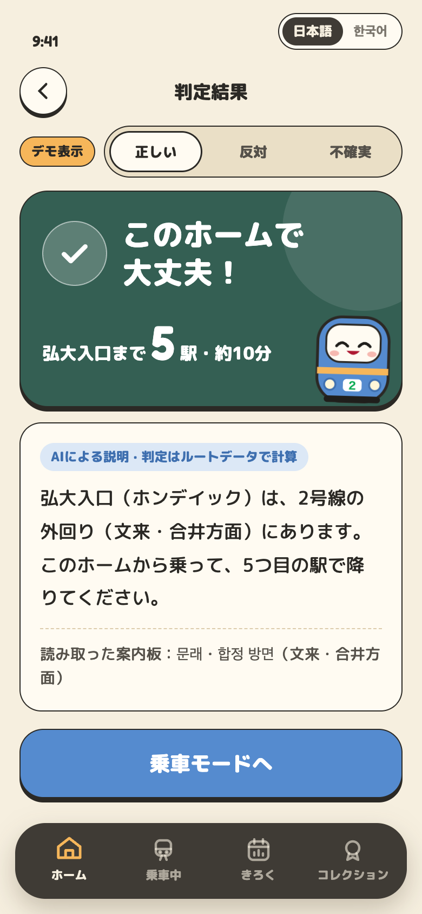
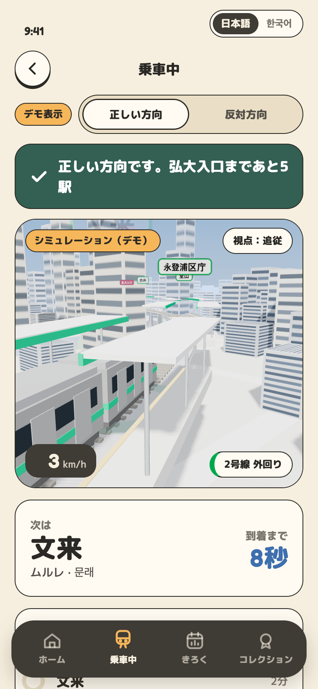
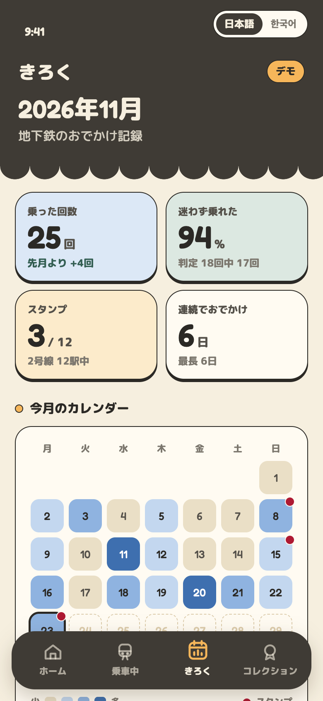

# SubStamp GO

**ホームの案内板を撮ると「この電車に乗っていいか」を日本語で教えてくれる、ソウル地下鉄の案内サービス**

韓国語の案内板と日本語の地図のあいだで迷わないよう、乗る方向をすぐに判定し、リアルタイムの列車情報で目的地まで案内します。 
着いた駅では駅名の由来がつまったスタンプを集め、クエストでソウルのあちこちを巡ります。

DigiMan Hackathon 2026 · テーマ「ソウルにいる日本人を喜ばせてください」

[한국어](https://github.com/DigiMan-Hackathon-2026) · **日本語**

## Tech Stack

| 分野 | 技術 |
|---|---|
| Frontend |   |
| OCR |   |
| Backend · Auth |    |
| Data |  |
| Demo |   |

> 技術スタックはまだ確定していません。Next.js のモノレポをベースに、OCR を端末の中で処理するか API で処理するかを検討しています。

## Screens

<table>
  <tr>
    <td align="center"> 案内板を撮る</td>
    <td align="center"> 方向の判定</td>
    <td align="center"> 乗車中の案内</td>
    <td align="center"> 到着スタンプ</td>
    <td align="center"> きろく</td>
  </tr>
</table>

テーマ選定段階のモックアップです。実際のサービス画面は変わる可能性があります。

## Features

| 機能 | 説明 |
|---|---|
| 方向の判定 | ホームの案内板を撮ると、目的地へ向かう方向かどうかを日本語ですぐに教えます。 |
| リアルタイム列車情報 | 実際の運行情報をもとに、次の電車と到着時刻を案内します。 |
| 目的地ごとの乗車案内 | 終着駅の表記や分岐する路線など、まぎらわしい区間でも目的地に合う電車を選びます。 |
| スタンプ | 訪れた駅で、駅名の由来や漢字・日本語の説明がのったスタンプを集めます。 |
| クエスト | 駅のまわりを巡るクエストで、地下鉄での移動を旅の一部にします。 |
| AR案内 | 実装できるかを検討中です。 |

## Team

| 名前 | GitHub |
|---|---|
| 최도일（チェ・ドイル） | [@novvvv](https://github.com/novvvv) |
| 한시온（ハン・シオン） | [@zionhann](https://github.com/zionhann) |
| 이상무（イ・サンム） | [@sangmu1126](https://github.com/sangmu1126) |
| 임종훈（イム・ジョンフン） | [@ImJongHoon](https://github.com/ImJongHoon) |
| 허민영（ホ・ミニョン） | |
| 유예은（ユ・イェウン） | |

## Repositories

| リポジトリ | 説明 |
|---|---|
| [idea](https://github.com/DigiMan-Hackathon-2026/idea) | テーマ選定に使ったアイデアのデモ集（2026.11.22 の会議） |
