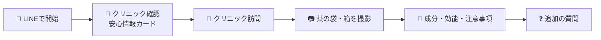
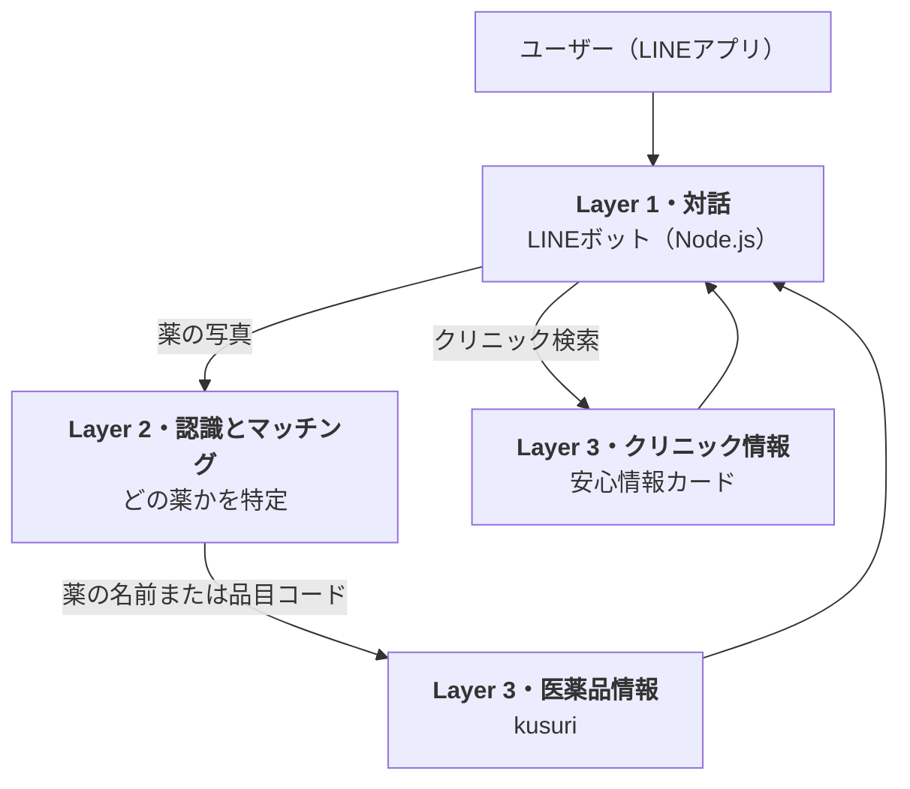

<div align="center">

# クリとも

**韓国のクリニックとお薬を、LINEで確認**

行く前にはクリニックの情報を確認でき、行った後には受け取ったお薬を日本語でご案内します。<br>
新しいアプリは不要で、LINEのトークで完結します。

DigiMan Hackathon 2026 · テーマ「ソウルにいる日本人を喜ばせてください」・開発中

[한국어](https://github.com/DigiMan-Hackathon-2026/.github/blob/main/profile/README.md) · **日本語**

</div>

## サービスの流れ



## レイヤー構成



| Layer | 役割 | リポジトリ | 状況 |
|---|---|---|---|
| 1・対話 | メッセージと写真を受け取り、カードで返信 | [line-stack](https://github.com/DigiMan-Hackathon-2026/line-stack)（開発・検証ツール） | 検証ツールと練習用ボットは実装済み、サービス用ボットは準備中 |
| 2・認識とマッチング | 写真からどの薬かを特定 | 未公開 | モデルを開発・試験中 |
| 3・医薬品情報 | 成分・効能・注意事項の案内 | [kusuri](https://github.com/DigiMan-Hackathon-2026/kusuri) | API実装済み、連携前 |
| 3・クリニック情報 | クリニック安心情報カード | 未公開 | 表示項目を確定 |

### Layer 1・対話

メッセージと写真を受け取り、後ろのPythonサーバーを呼び出して、親しみやすい日本語で返信するLINEボットサーバーです。
`line-stack`は、AIエージェントが実際のスマートフォンのLINE画面でボットの返信を確認するための開発ツールで、練習用ボット`hello-bot`を含みます。Androidに対応し、iOSは対応予定です。

### Layer 2・認識とマッチング

> このレイヤーはまだリポジトリにありません。以下はチームで決めた処理の流れです。

1. 写真からVLM/OCRで文字と特徴を読み取ります。
2. ブースティングモデルが候補を約20件に絞ります。
3. LLMが候補を再確認し、1件に確定するか、ユーザーが選ぶ候補を表示します。

LLMが存在しない薬の名前を作り出さないよう、先に候補を絞ってから確認します。

### Layer 3・医薬品情報（`kusuri`）

特定された薬の情報を、韓国の食品医薬品安全処の医薬品許可情報をもとに案内します。

| 機能 | 方法 |
|---|---|
| 薬の確認と成分 | 薬の名前のルールマッチング、公式データと成分辞書 |
| 効能・注意事項 | 許可文書の決まった項目を日本語に翻訳 |
| 追加の質問 | その薬の許可文書を検索して回答（RAG） |

### Layer 3・クリニック情報

クリニック安心情報カードには次の項目を表示します。

- 医療機関名
- 所在地
- 診療科目
- 開設日
- 外国人患者誘致機関の登録有無

## 表示例

医薬品情報モジュールが作るLINEメッセージの一部です。

```text
타이레놀정500밀리그람(아세트아미노펜)

【成分】
・アセトアミノフェン（아세트아미노펜） 500mg

【効能】
かぜによる発熱および疼痛（痛み）、頭痛、神経痛、筋肉痛、月経痛 …

【使ってはいけない場合】
1) この薬に対して過敏症のある患者
2) 消化性潰瘍のある患者
…
```

> クリともは公開情報を案内するサービスです。診断や服用してよいかの判断は行いません。医師・薬剤師に相談してください。

## Tech Stack

| 分野 | 技術 |
|---|---|
| 対話 |     |
| 認識とマッチング |    |
| 医薬品情報 |     |

## Team

| 名前 | GitHub |
|---|---|
| 최도일（チェ・ドイル） | [@novvvv](https://github.com/novvvv) |
| 한시온（ハン・シオン） | [@zionhann](https://github.com/zionhann) |
| 이상무（イ・サンム） | [@sangmu1126](https://github.com/sangmu1126) |
| 임종훈（イム・ジョンフン） | [@ImJongHoon](https://github.com/ImJongHoon) |
| 허민영（ホ・ミニョン） | |
| 유예은（ユ・イェウン） | |

## リポジトリ

| リポジトリ | Layer | 説明 |
|---|---|---|
| [line-stack](https://github.com/DigiMan-Hackathon-2026/line-stack) | 1 | LINEボットを実機で検証するClaude Codeプラグインと練習用ボット（非公開） |
| [kusuri](https://github.com/DigiMan-Hackathon-2026/kusuri) | 3 | 韓国の薬の成分・効能・注意事項を日本語で案内するAPI（非公開） |
| [idea](https://github.com/DigiMan-Hackathon-2026/idea) | - | テーマ選定に使ったアイデアデモ集（2026年11月22日の会議） |
