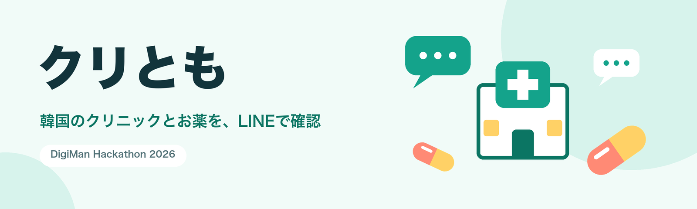
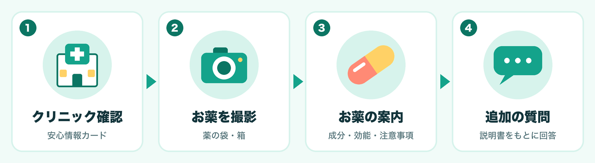

**写真1枚で韓国のクリニックと処方薬を確認できる、日本人旅行者向けLINEボット**

DigiMan Hackathon 2026「ソウルにいる日本人を喜ばせてください」出品作

現在ハッカソンで開発中のため、企画とアーキテクチャは実装の過程で一部変更される場合があります。

[한국어](https://github.com/DigiMan-Hackathon-2026/.github/blob/main/profile/README.md) · **日本語**

## 技術スタック

ボットのインターフェースはLINE Messaging API、Node.js、TypeScript、Expressを基盤に動作し、バックエンドとAIパイプラインはPython、FastAPI、VLM/OCR、LightGBM、Qdrant、Geminiを中心に構成しています。

          

## プロジェクトの背景

短い日程でソウルを訪れて肌・美容の施術を受ける日本人旅行者は、来院の前と後の2回、情報の空白に直面します。施術前には、SNS広告や予約ページで知ったクリニックが正式に開設届を出した医療機関なのか、保健福祉部に登録された外国人患者誘致機関なのかを、日本語で直接確かめる方法がほとんどありません。施術を終えた後も同じです。薬局で受け取る薬の袋や箱には韓国語しか書かれておらず、自分が飲む薬がどんな成分で、何に気をつけるべきかを把握するのは困難です。

クリともは、専用アプリのインストールや複雑なメニュー操作を必要とせず、いつものLINEトークに広告のスクリーンショットや薬の写真を送るだけで、この問題の解決を目指します。送られた画像から要点を読み取り、韓国の公共データと照合したうえで、旅行者がすぐに理解できる日本語の結果カードにまとめて返します。

## 私たちが守るデータ原則

医療と医薬品の情報は、誤った案内がそのまま健康上のリスクにつながるため、モデルの推測や拡大解釈を排除する方向でシステムを設計しました。

クリともは特定の病院や医薬品をおすすめ・評価せず、医学的な診断や違法性の判定も行いません。健康保険審査評価院、保健福祉部、食品医薬品安全処などの公的機関の公共データに掲載された事実をお伝えします。その際、公式データで確認できた事実と確認できない領域をはっきり分けて表示します。たとえば、外国人患者誘致機関の登録有無は公式データで確認しますが、現場の日本語通訳の常駐、施術の品質、最終的な支払額は未確認の項目として線を引きます。

案内カードには、データの出典機関と基準日を明示することを原則とします。同じ名前の病院や含有量だけが違う同一製品群のように照合結果が曖昧な場合は、勝手に1件に決めつけず、候補を示してユーザー自身に選んでもらいます。読み取れない写真や名簿にない項目は「確認不可」と明確に案内します。服用と施術の最終判断は現場の医師と薬剤師に委ねることを、すべての応答の前提とします。

## 利用の流れと仕組み

利用の流れは大きく、施術前のクリニック確認と施術後の医薬品確認に分かれます。クリニックの広告や予約確認画面をトークに送ると、医療機関名、所在地、診療科目、開設日、外国人患者誘致機関の登録有無をまとめた安心情報カードを受け取れます。施術後に薬局で受け取った薬の袋や箱を撮影して送ると、それぞれの薬の主成分、効能・効果、服用時の注意事項が日本語で届きます。案内の後に「妊娠中でも服用できますか？」のように気になることを質問すると、その医薬品の公式な許可文書を検索し、根拠に基づいて回答します。

この過程でシステムは、認識の正確さに応じて応答を4つの状態に分けます。公式データの1件と正確に一致すればすぐに結果カードを送り、似た名前や含有量の違いで複数の候補がある場合は選択肢を表示して確認を求めます。公式名簿に見つからない、または信頼度の基準に満たない場合は推測せず未確認カードを送り、光の反射や低解像度で文字が読めない場合は撮り直しをお願いします。

## システムアーキテクチャとリポジトリ構成

サービス全体は、ユーザー接点、エンティティマッチング、ドメインデータ処理という3つのレイヤーに役割を分けて構築しています。

| Layer | 役割 | リポジトリ | 状況 |
|---|---|---|---|
| 1 | 対話インターフェース | [line-stack](https://github.com/DigiMan-Hackathon-2026/line-stack)（開発・検証ツール、非公開） | サービス用ボット準備中 |
| 2 | 認識とエンティティマッチング | 未公開 | 開発・試験中 |
| 3 | 医薬品情報 | [kusuri](https://github.com/DigiMan-Hackathon-2026/kusuri)（非公開） | API実装済み、連携前 |
| 3 | クリニック情報 | 未公開 | 実装準備 |

### Layer 1・対話インターフェース

ユーザーが直接触れるLINEボットです。Webhookで画像とテキストメッセージを受け取ってバックエンドに渡し、処理結果を直感的な日本語のFlex Messageカードとアクションボタンで表示します。このレイヤーの開発効率を高めるために作った`line-stack`リポジトリには、Claude Codeエージェントが実際のAndroid端末のLINE画面でボットの返信を確認してから作業を完了するようにする開発プラグインと、テスト用ボット（`hello-bot`）が含まれています。

### Layer 2・認識とエンティティマッチング

画像内の日本語・英語の病院名や韓国語の医薬品名を、韓国の公式名簿の標準名称に結び付ける中核パイプラインです。まずVLMとOCRで写真からテキストを抽出し、LightGBMベースの分類・ランキングモデルで一次候補を絞り込み、一致する確率を計算します。最後にLLMがスコアと文脈を再検討し、1件に確定、候補を提示、未確認のいずれかを判定します。現在はモデルの調整と試験を進めており、安定した後に別のリポジトリとして公開する予定です。

### Layer 3・ドメインデータ処理

確定した病院と薬の詳しい情報を作ります。

医薬品を担当する`kusuri`リポジトリは、Python（FastAPI）のAPIサーバーと、LINEボット連携用のTypeScriptクライアント（`clients/line-bot`）で構成されています。食品医薬品安全処の医薬品許可情報をもとに、医薬品名の一覧を標準成分と品目コードに対応付け（`/v1/drug/prescription`）、薬の効能と注意事項を日本語に翻訳して提供します（`/v1/drug/info`）。追加の質問（`/v1/drug/ask`）には、QdrantベクトルDB（`embeddinggemma`）とGeminiを組み合わせたRAGパイプラインで、許可文書の原文を根拠に回答します。

クリニック分野では、健康保険審査評価院の医療機関基本情報と保健福祉部の誘致機関登録データを組み合わせて応答カードを構成します。現在はデータ構造を定め、実装を準備しています。

2026年11月22日の初回企画会議でアイデアを検証するために作ったプロトタイプは、[idea](https://github.com/DigiMan-Hackathon-2026/idea)リポジトリに保管しています。

## チーム

このプロジェクトは6人のメンバーで制作しています。

| 최도일（チェ・ドイル） | 한시온（ハン・シオン） | 이상무（イ・サンム） | 임종훈（イム・ジョンフン） | 허민영（ホ・ミニョン） | 유예은（ユ・イェウン） |
|:-:|:-:|:-:|:-:|:-:|:-:|
| [@novvvv](https://github.com/novvvv) | [@zionhann](https://github.com/zionhann) | [@sangmu1126](https://github.com/sangmu1126) | [@ImJongHoon](https://github.com/ImJongHoon) |  |  |
