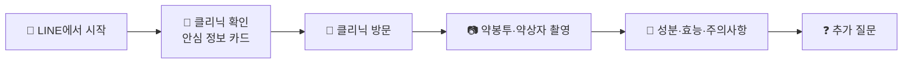
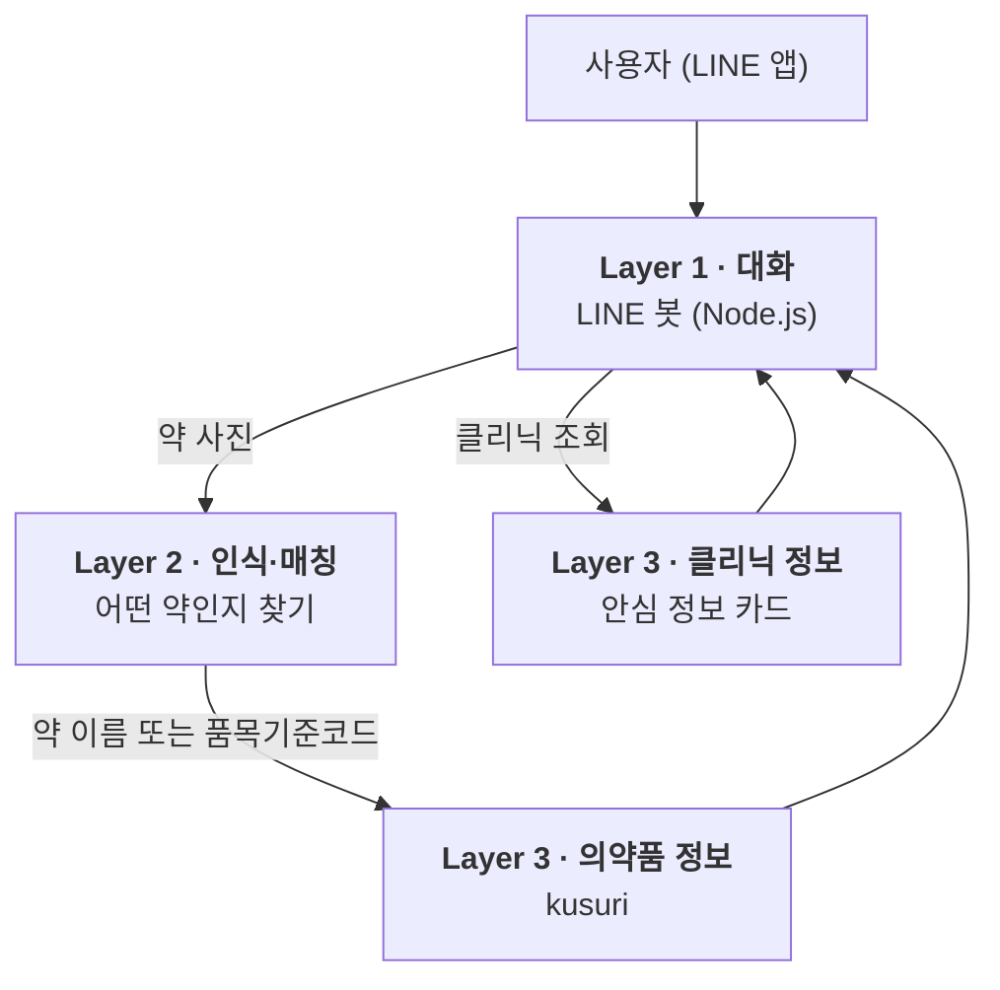

<div align="center">

# クリとも

**한국의 클리닉과 약을 LINE에서 확인하는 일본인 여행객용 챗봇**

가기 전에는 클리닉 정보를 확인하고, 다녀온 뒤에는 받은 약이 무엇인지 일본어로 알려 줍니다.<br>
앱을 새로 설치하지 않고 LINE 대화로 이어집니다.

DigiMan Hackathon 2026 · 주제 「서울에 있는 일본인을 기쁘게 해 주세요」 · 개발 중

**한국어** · [日本語](https://github.com/DigiMan-Hackathon-2026/.github/blob/main/profile/README.ja.md)

</div>

## Service Flow



## Layers



| Layer | 하는 일 | 저장소 | 상태 |
|---|---|---|---|
| 1 · 대화 | 메시지와 사진을 받고 카드로 답장 | [line-stack](https://github.com/DigiMan-Hackathon-2026/line-stack) (개발·검증 도구) | 검증 도구와 연습용 봇 구현, 서비스 봇은 준비 중 |
| 2 · 인식·매칭 | 사진에서 어떤 약인지 찾기 | 업로드 전 | 모델 개발·시험 중 |
| 3 · 의약품 정보 | 성분·효능·주의사항 안내 | [kusuri](https://github.com/DigiMan-Hackathon-2026/kusuri) | API 구현, 연동 전 |
| 3 · 클리닉 정보 | 클리닉 안심 정보 카드 | 업로드 전 | 표시 항목 확정 |

### Layer 1 · 대화

사용자의 메시지와 사진을 받아 뒤의 파이썬 서버를 부르고, 친근한 일본어로 답하는 LINE 봇 서버입니다.
`line-stack`은 에이전트가 실제 휴대폰의 LINE 화면으로 봇의 답장을 확인하도록 만든 개발 도구이며, 연습용 봇 `hello-bot`이 들어 있습니다. Android 검증을 지원하고 iOS는 예정입니다.

### Layer 2 · 인식·매칭

> 아직 저장소에 올라오지 않은 레이어입니다. 아래는 팀에서 정한 처리 방식입니다.

1. 사진에서 VLM/OCR로 글자와 특징을 읽습니다.
2. 부스팅 모델이 후보 약 20개를 고릅니다.
3. LLM이 후보를 다시 확인해 약 하나를 정하거나, 사용자가 고를 후보를 보여 줍니다.

LLM이 없는 약 이름을 지어내지 않도록, 후보를 먼저 좁힌 뒤 LLM으로 확인합니다.

### Layer 3 · 의약품 정보 (`kusuri`)

확정된 약의 정보를 식약처 의약품 허가정보를 바탕으로 안내합니다.

| 기능 | 방식 |
|---|---|
| 약 확인과 성분 | 약 이름 규칙 매칭, 식약처 데이터와 성분 사전 |
| 효능·주의사항 | 허가문서의 정해진 항목을 일본어로 번역 |
| 추가 질문 | 해당 약의 허가문서를 검색해 답변 (RAG) |

### Layer 3 · 클리닉 정보

클리닉 안심 정보 카드에 아래 항목을 보여 줍니다.

- 의료기관명
- 소재지 주소
- 진료 분야 (표시 과목)
- 개설일
- 외국인 환자 유치기관 등록 여부

## Example

의약품 정보 모듈이 만드는 LINE 메시지의 일부입니다.

```text
타이레놀정500밀리그람(아세트아미노펜)

【成分】
・アセトアミノフェン（아세트아미노펜） 500mg

【効能】
かぜによる発熱および疼痛（痛み）、頭痛、神経痛、筋肉痛、月経痛 …

【使ってはいけない場合】
1) この薬に対して過敏症のある患者
2) 消化性潰瘍のある患者
…
```

> クリとも는 공개 정보를 안내하는 서비스입니다. 진단하거나 약을 먹어도 되는지 판단하지 않으며, 의사·약사와 상담해야 합니다.

## Tech Stack

| 영역 | 기술 |
|---|---|
| 대화·화면 |     |
| 인식·매칭 |    |
| 의약품 정보 |     |

## Team

| 이름 | GitHub |
|---|---|
| 최도일 | [@novvvv](https://github.com/novvvv) |
| 한시온 | [@zionhann](https://github.com/zionhann) |
| 이상무 | [@sangmu1126](https://github.com/sangmu1126) |
| 임종훈 | [@ImJongHoon](https://github.com/ImJongHoon) |
| 허민영 | |
| 유예은 | |

## Repositories

| 레포 | Layer | 설명 |
|---|---|---|
| [line-stack](https://github.com/DigiMan-Hackathon-2026/line-stack) | 1 | LINE 봇을 실기기에서 검증하는 Claude Code 플러그인과 연습용 봇 (비공개) |
| [kusuri](https://github.com/DigiMan-Hackathon-2026/kusuri) | 3 | 한국 약의 성분·효능·주의사항을 일본어로 안내하는 API (비공개) |
| [idea](https://github.com/DigiMan-Hackathon-2026/idea) | - | 주제 선정에 쓴 아이디어 데모 모음 (2026.11.22 회의) |
