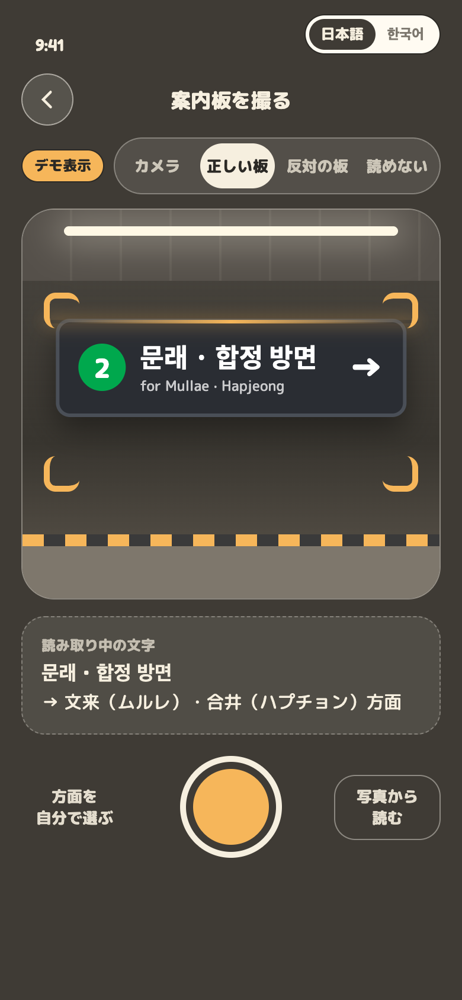
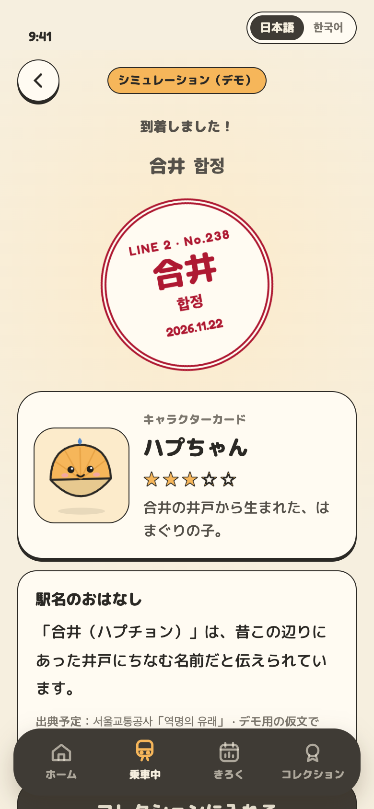

# SubStamp GO

**승강장 표지판을 찍으면 "이 열차를 타도 되는지" 일본어로 알려 주는 서울 지하철 안내 서비스**

한국어 표지판과 일본어 지도 사이에서 헤매지 않도록 탑승 방향을 바로 판별하고, 실시간 열차 정보로 목적지까지 안내합니다. 
도착한 역에서는 역 이름 이야기가 담긴 스탬프를 모으고, 퀘스트로 서울 곳곳을 돌아봅니다.

DigiMan Hackathon 2026 · 주제 「서울에 있는 일본인을 기쁘게 해 주세요」

**한국어** · [日本語](https://github.com/DigiMan-Hackathon-2026/.github/blob/main/profile/README.ja.md)

## Tech Stack

| 영역 | 기술 |
|---|---|
| Frontend |   |
| OCR |   |
| Backend · Auth |    |
| Data |  |
| Demo |   |

> 스택은 아직 확정 전입니다. Next.js 모노레포 위에서 OCR을 기기 안에서 처리할지 API로 처리할지 검토하고 있습니다.

## Screens

<table>
  <tr>
    <td align="center"> 표지판 촬영</td>
    <td align="center"> 방향 판별</td>
    <td align="center"> 탑승 안내</td>
    <td align="center"> 도착 스탬프</td>
    <td align="center"> 기록</td>
  </tr>
</table>

주제 선정 단계의 목업 데모 화면입니다. 실제 서비스 화면은 달라질 수 있습니다.

## Features

| 기능 | 설명 |
|---|---|
| 방향 판별 | 승강장 표지판을 찍으면 목적지로 가는 방향이 맞는지 일본어로 바로 알려 줍니다. |
| 실시간 열차 정보 | 실제 운행 정보를 기준으로 다음 열차와 도착 시간을 안내합니다. |
| 목적지별 탑승 안내 | 종착역 표기나 분기 노선처럼 헷갈리는 구간에서도 목적지에 맞는 열차를 골라 줍니다. |
| 스탬프 | 방문한 역에서 역 이름의 유래와 한자·일본어 설명이 담긴 스탬프를 모읍니다. |
| 퀘스트 | 역 주변을 돌아보는 퀘스트로 지하철 이동을 여행의 일부로 만듭니다. |
| AR 안내 | 구현 가능성을 검토 중입니다. |

## Team

| 이름 | GitHub |
|---|---|
| 최도일 | [@novvvv](https://github.com/novvvv) |
| 한시온 | [@zionhann](https://github.com/zionhann) |
| 이상무 | [@sangmu1126](https://github.com/sangmu1126) |
| 임종훈 | [@ImJongHoon](https://github.com/ImJongHoon) |
| 허민영 | |
| 유예은 | |

## Repositories

| 레포 | 설명 |
|---|---|
| [idea](https://github.com/DigiMan-Hackathon-2026/idea) | 주제 선정에 쓴 아이디어 데모 모음 (2026.11.22 회의) |
