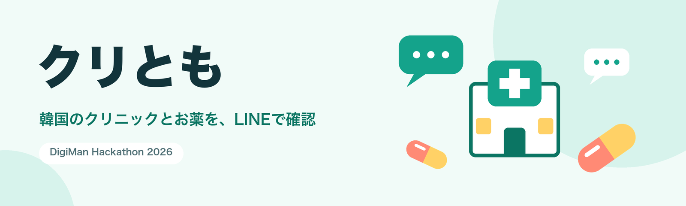
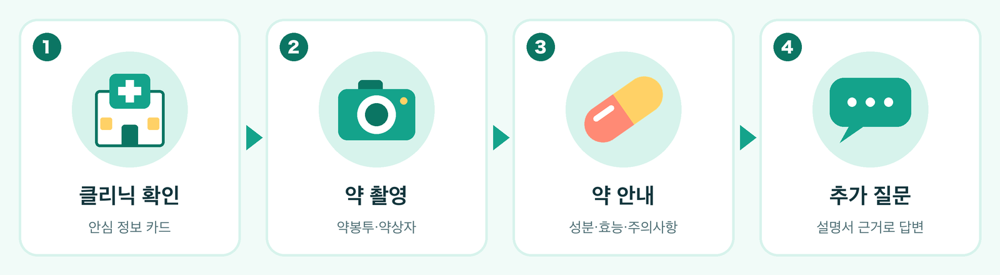

**사진 한 장으로 한국의 클리닉과 약을 확인하는 일본인 여행객용 LINE 봇**

DigiMan Hackathon 2026 「서울에 있는 일본인을 기쁘게 해 주세요」 출품작

해커톤 개발이 진행 중이며, 기획과 구조는 구현 과정에서 바뀔 수 있습니다.

**한국어** · [日本語](https://github.com/DigiMan-Hackathon-2026/.github/blob/main/profile/README.ja.md)

## 프로젝트 배경

짧은 일정으로 서울을 찾아 피부·미용 시술을 받는 일본인 여행객은 방문 전과 후, 두 번의 정보 공백을 마주합니다.

- **시술 전**: SNS 광고나 예약 페이지에서 본 클리닉이 정식 개설 신고된 의료기관인지, 보건복지부에 등록된 외국인환자 유치기관인지 일본어로 확인하기 어렵습니다.
- **시술 후**: 약국에서 받은 약봉투와 상자에는 한국어만 적혀 있어, 어떤 성분이고 무엇을 조심해야 하는지 알기 어렵습니다.

クリとも는 앱을 설치하거나 메뉴를 찾을 필요 없이, 평소 쓰는 LINE 채팅방에 광고 캡처나 약 사진을 보내는 것으로 이 문제를 풀고자 합니다. 사진의 핵심 정보를 읽어 공공 데이터와 대조한 뒤 일본어 결과 카드로 돌려줍니다.

## 데이터 원칙

의료 정보는 잘못 안내하면 건강상의 위험으로 이어질 수 있어, 추측과 과잉 해석을 배제하도록 설계합니다.

- **추천·평가·판정을 하지 않습니다.** 진단이나 위법 여부도 판단하지 않고, 건강보험심사평가원·보건복지부·식품의약품안전처의 공공 데이터에 있는 사실을 전합니다.
- **확인된 것과 확인되지 않은 것을 나눕니다.** 유치기관 등록 여부는 확인해 주지만, 일본어 통역 상주, 시술 품질, 최종 결제 금액은 확인되지 않은 항목으로 표시합니다.
- **출처와 기준일을 함께 밝히는 것을 원칙으로 합니다.**
- **애매하면 단정하지 않습니다.** 같은 이름의 병원이나 함량만 다른 제품은 후보를 보여 주고 고르게 합니다.
- **복용과 시술 판단은 의사와 약사에게 맡깁니다.**

## 이용 흐름

- **시술 전**: 클리닉 광고나 예약 화면을 보내면 의료기관명, 주소, 진료 분야, 개설일, 외국인환자 유치기관 등록 여부를 담은 안심 정보 카드를 받습니다.
- **시술 후**: 약봉투나 약상자를 찍어 보내면 성분, 효능, 주의사항을 일본어로 받습니다.
- **추가 질문**: "임신 중에도 복용할 수 있나요?"처럼 물어보면 해당 약의 허가문서를 찾아 근거와 함께 답합니다.

응답은 확인 수준에 따라 네 가지로 나뉩니다.

| 상태 | 언제 | 응답 |
|---|---|---|
| **확인** | 공식 데이터의 한 항목과 일치 | 결과 카드 |
| **후보** | 비슷한 이름이나 함량 차이로 여러 개 | 선택지 제시 |
| **확인 불가** | 명단에 없거나 신뢰도가 낮음 | 추측 없이 미확인 안내 |
| **재촬영** | 빛 번짐·저해상도로 읽을 수 없음 | 사진을 다시 요청 |

## 아키텍처와 저장소

| Layer | 역할 | 저장소 | 상태 |
|---|---|---|---|
| **1 대화** | 사용자 접점 | [line-stack](https://github.com/DigiMan-Hackathon-2026/line-stack) (개발·검증 도구, 비공개) | 서비스 봇 준비 중 |
| **2 인식·매칭** | 어느 병원·약인지 특정 | 업로드 전 | 개발·시험 중 |
| **3 의약품 정보** | 약 설명 | [kusuri](https://github.com/DigiMan-Hackathon-2026/kusuri) (비공개) | API 구현, 연동 전 |
| **3 클리닉 정보** | 병원 설명 | 업로드 전 | 구현 준비 |

### Layer 1 · 대화 인터페이스

LINE 봇이 Webhook으로 사진과 메시지를 받아 백엔드에 넘기고, 결과를 일본어 카드와 버튼으로 보여 줍니다. `line-stack`에는 Claude Code 에이전트가 실제 Android 기기의 LINE 화면에서 봇의 답장을 확인한 뒤 작업을 마치도록 하는 플러그인과 연습용 봇(`hello-bot`)이 있습니다.

### Layer 2 · 인식과 매칭

사진 속 일본어·영문 병원명이나 한국어 약 이름을 공식 명단의 명칭과 연결합니다.

1. VLM/OCR로 사진의 글자를 읽습니다.
2. LightGBM 모델이 후보를 좁히고 매칭 확률을 계산합니다.
3. LLM이 점수와 문맥을 다시 확인해 확정, 후보 제시, 확인 불가를 판정합니다.

### Layer 3 · 의약품 정보 (`kusuri`)

Python(FastAPI) API 서버와 LINE 봇용 TypeScript 클라이언트(`clients/line-bot`)로 구성됩니다.

| API | 하는 일 |
|---|---|
| `/v1/drug/prescription` | 약 이름 목록 → 성분과 품목코드 |
| `/v1/drug/info` | 약 하나 → 효능과 주의사항을 일본어로 번역 |
| `/v1/drug/ask` | 추가 질문 → 허가문서를 근거로 답변 (RAG: Qdrant, `embeddinggemma`, Gemini) |

### Layer 3 · 클리닉 정보

건강보험심사평가원의 의료기관 정보와 보건복지부의 유치기관 등록 데이터를 결합해 안심 정보 카드를 만들 예정입니다.

2026년 11월 22일 주제 선정 때 만든 프로토타입은 <a href="https://github.com/DigiMan-Hackathon-2026/idea">idea</a> 저장소에 있습니다.

## 기술 스택

          

## 팀

| 최도일 | 한시온 | 이상무 | 임종훈 | 허민영 | 유예은 |
|:-:|:-:|:-:|:-:|:-:|:-:|
| [@novvvv](https://github.com/novvvv) | [@zionhann](https://github.com/zionhann) | [@sangmu1126](https://github.com/sangmu1126) | [@ImJongHoon](https://github.com/ImJongHoon) |  |  |
